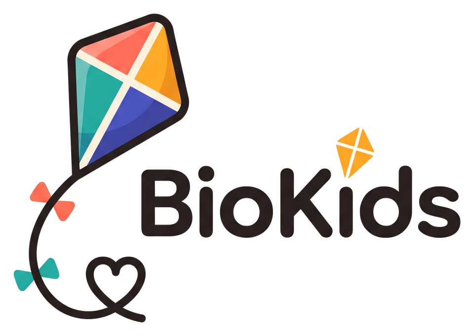
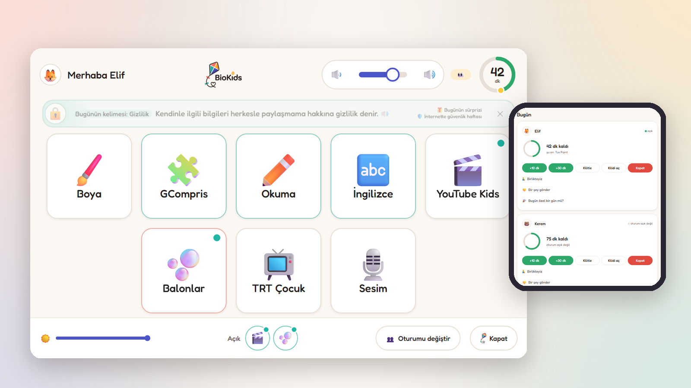
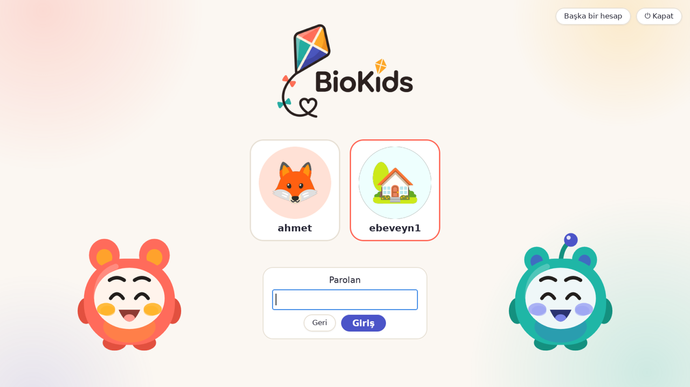
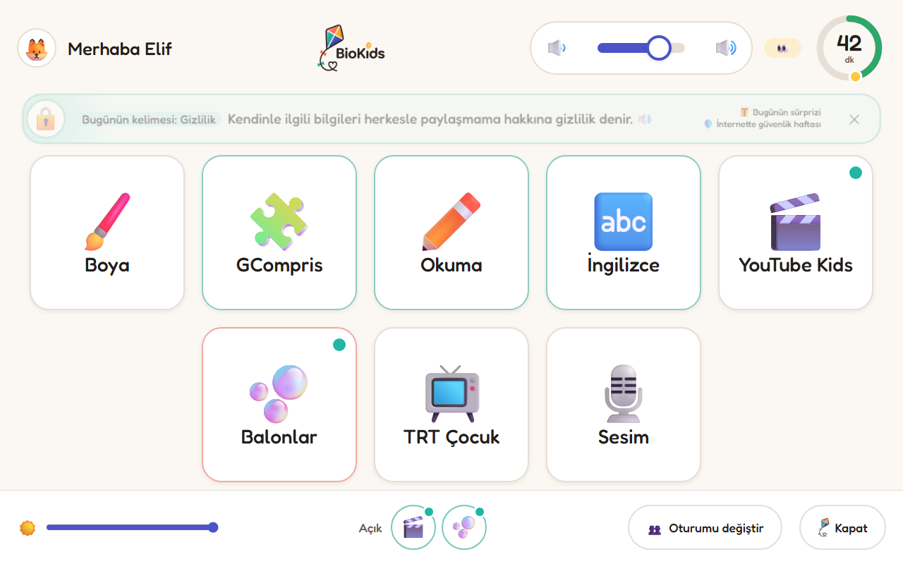
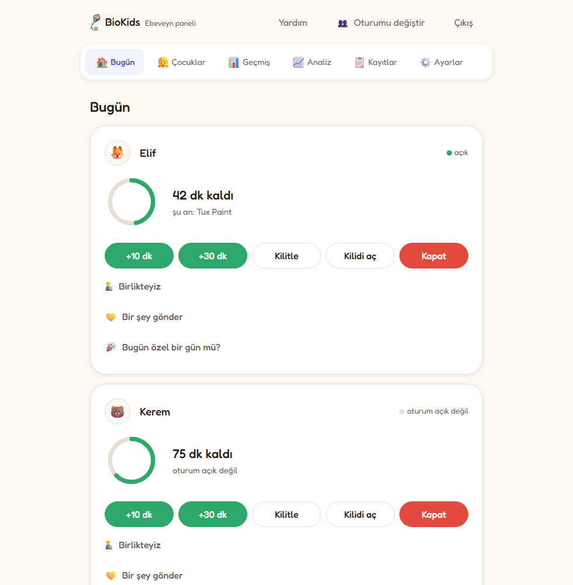
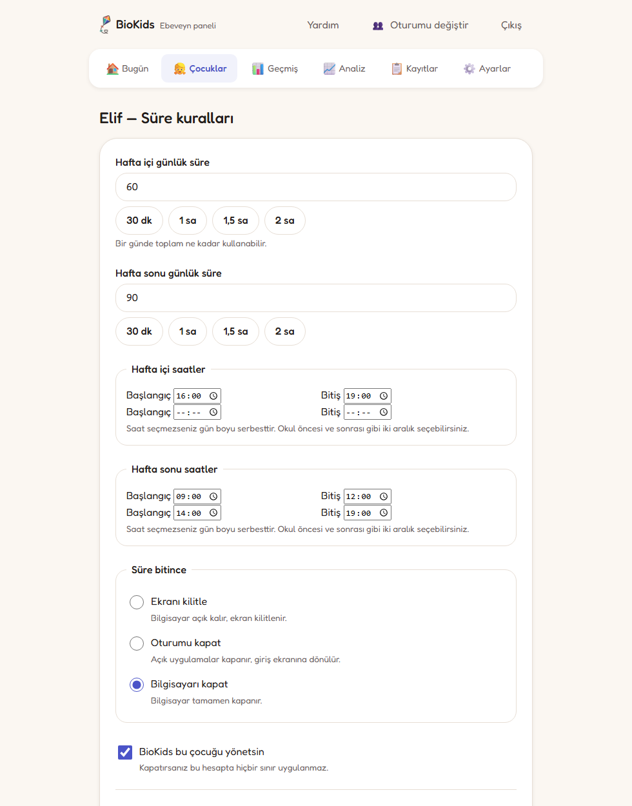
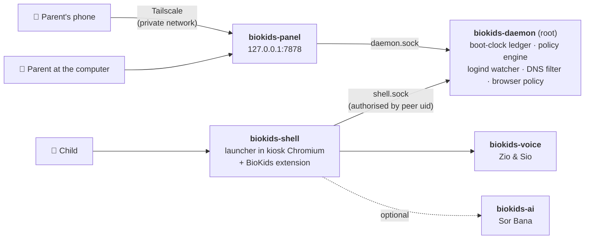

<div align="center">



### Parental controls for Debian that stay on your own computer

For children aged 4–10 · no account · no cloud · nothing leaves the device

*Çocuklar için, tamamen kendi bilgisayarınızda çalışan ebeveyn denetimi.*

[](https://github.com/bilalgurkansanli/BioKids/actions/workflows/ci.yml)
[](https://github.com/bilalgurkansanli/BioKids/releases)
[](LICENSE)
[](https://www.debian.org/releases/trixie/)
[](pyproject.toml)

**[Website](https://biokids.bilalgurkansanli.com)** ·
**[Download](#download)** ·
**[Guides & support](https://biokids.bilalgurkansanli.com)** ·
**[Documentation](#documentation)** ·
**[Contributing](CONTRIBUTING.md)**

<br>



</div>

---

BioKids turns a Debian 13 computer into one a young child can use on their own. They
log in by tapping their picture, land in a launcher of big tiles instead of a desktop,
and are told — out loud — when their time is nearly up. The parent sets the rules from
a panel on the same computer or on their phone. Time is counted in a way a changed clock
cannot cheat, harmful sites are closed for the children's accounts only, and **nothing
about the family leaves the machine.**

It comes as a ready-to-install ISO (Debian 13 with BioKids, which installs beside
Windows if you want) and as Debian packages for a computer that already runs Debian.

> **BioKids 2.0.0.** The packages build, pass lintian, install, upgrade and purge on
> Debian 13, and the ISO was installed in VirtualBox (BIOS and UEFI) and beside Windows
> on real hardware. What comes next is in [`docs/ROADMAP.md`](docs/ROADMAP.md).

## Why BioKids

<table>
<tr>
<td width="50%" valign="top">

**🏠 It stays at home.** No telemetry, no analytics, no account, no cloud. The panel
reaches your phone over your own private network, never through a BioKids server —
there is no BioKids server.

</td>
<td width="50%" valign="top">

**👀 The child knows.** Supervision is always visible. The first run explains what the
family can see, and when a parent looks at the screen live, the child sees
"👁 Annen ekranını görüyor" for as long as it lasts.

</td>
</tr>
<tr>
<td valign="top">

**⏱️ Time that cannot be cheated.** Minutes are counted with the kernel's boot clock, so
moving the system clock changes nothing — and the change is written in the audit log.

</td>
<td valign="top">

**🧸 Made for ages 4 to 10.** Big tiles, a ring of minutes, buttons that speak for
children who cannot read yet, and two companions, Zio and Sio, who tell them what is
happening.

</td>
</tr>
</table>

## Screenshots

<table>
<tr>
<td width="50%"></td>
<td width="50%"></td>
</tr>
<tr>
<td align="center"><b>Log in by picture.</b> A child just taps; only the parent's account asks for a password.</td>
<td align="center"><b>The launcher.</b> The apps the parent chose, the minutes left, and what is open.</td>
</tr>
<tr>
<td></td>
<td></td>
</tr>
<tr>
<td align="center"><b>Today.</b> One card per child: the time left, what is on screen, +10 min, lock, shut down.</td>
<td align="center"><b>History.</b> A year at a glance, the last two weeks, and any day in detail.</td>
</tr>
<tr>
<td></td>
<td></td>
</tr>
<tr>
<td align="center"><b>Time rules.</b> A few clear controls; the rest is behind <i>Gelişmiş</i>.</td>
<td align="center"><b>A closed site</b> is a friendly page with a <i>Büyüğüme sor</i> (ask a grown-up) button.</td>
</tr>
</table>

## Features

### For the child

- **A launcher instead of a desktop.** Big tiles for the apps and sites the parent
  chose, a ring with the minutes left, and the same buttons over every app: home, the
  app's own volume, a fullscreen button for apps that open small, and a close that works
  even on an app that will not close. No desktop, no settings, no terminal.
- **Switch without starting over.** Open apps and sites wait at the bottom of the
  launcher: stop a video, play a game, and come back to the video where it was.
- **Login by picture**, two age bands (4–7 and 8–10), and tiles and screens that read
  themselves aloud for children who cannot read yet.
- **Zio and Sio**, a mother's and a father's voice, speak the warnings at 10, 5 and
  1 minute — espeak-ng out of the box, a natural Piper voice one button away, or the
  parent's own recorded voice.
- **Learning corners.** Turkish reading in first grade's order, from letters to
  sentences, and an English corner with Sio.
- **Ask a grown-up.** More time, a site or an app: the request reaches the parent's
  phone, is answered in one tap, and the child is told the answer.
- **Sesim**: the child can send their parent a recording of their own.

### For the parent

- **Time limits** with daily quotas, allowed hours and weekday, weekend or per-day
  rules. At the end the screen locks, counts down, and the computer shuts down — or
  only locks, or logs out: the parent chooses.
- **Breaks and earned time.** Optional forced breaks with a few moves for the eyes;
  learning apps can earn extra game time; games can wait until the day's learning is
  done; limits per kind of app (games, learning, web).
- **A gentle end.** Once a day the child may ask for a last round to finish what they
  are doing, and the end screens suggest something to do away from the screen.
- **The panel**, in the applications menu and on the parent's phone over their own
  private network (Tailscale, set up with one button; no port forwarding, ever).
  Mail notifications go through the parent's own mail server.
- **A live view of the screen**, asked for in the panel, shown to the child while it
  lasts, and kept nowhere.
- **History and an audit log.** Two weeks of minutes in detail and a year as a map;
  every rule change, PIN attempt, grant and clock change in the log.
- **The warm side.** "Aferin!" in one tap or a short note to the child's screen;
  "Birlikteyiz" while you play together, when nothing is counted; a few things to talk
  about in the evening, from the child's day.
- **Peace of mind.** A protection checklist that says what is in place and what to do
  where something is not, and an encrypted backup to move everything to a new computer.

### Filtering

- **The internet is open, with the worst of it closed**: adult, gambling, malware and
  scam sites, by a DNS filter on the machine (dnsmasq and nftables) that applies to the
  children's accounts only. Or a child can be switched to *only the sites I choose*.
- **SafeSearch is forced**, a managed Chromium policy closes what a browser could open
  around it, and the BioKids extension turns a closed site into a friendly page.
- **No man-in-the-middle proxy**: BioKids never decrypts anyone's traffic.

### Optional: Sor Bana, an assistant on the computer

A child types or, if allowed, says a question and gets an answer for their age from a
language model running **on the machine** (Gemma through llama.cpp, Whisper for speech),
checked against an offline Wikipedia. It refuses what a child should not ask, and the
parent sees what it refused. It is a separate package, off until a parent downloads it
and turns it on for a child; an ordinary question is answered and forgotten.

## Download

### The ISO — for a new or spare computer

The image is Debian 13 with Xfce, BioKids, the children's apps and the assistant's
runtime. It boots as a live system for trying, and installs with Debian's own installer
— in BioKids' look — with no network needed. On a computer with Windows, the installer
offers to shrink Windows and install beside it; the boot menu then lists both.

1. Download the ISO from the [latest release](https://github.com/bilalgurkansanli/BioKids/releases).
   It is over 2 GB, so the release links to its copy on archive.org, with its SHA256.
2. Write it to a USB stick of 8 GB or more (balenaEtcher, Rufus in DD mode, or `dd`).
3. Boot from the stick and choose **Start installer**.

[`iso/README.md`](iso/README.md) has the steps for a computer that has Windows, and how
the image is built.

### The packages — on an existing Debian 13

> **Not published yet.** Releases go to the project's own APT repository,
> `https://apt.biokids.bilalgurkansanli.com`, signed with a release key that does not
> exist yet. The repository and the key's fingerprint arrive together, and the
> fingerprint will be printed here. Until then, build the packages from this repository:
> [`docs/VM-RUNBOOK.md`](docs/VM-RUNBOOK.md) §1.

Once it is published:

```bash
curl -fsSL https://apt.biokids.bilalgurkansanli.com/KEY.gpg \
  | sudo tee /usr/share/keyrings/biokids-archive-keyring.gpg > /dev/null

echo "deb [signed-by=/usr/share/keyrings/biokids-archive-keyring.gpg] \
https://apt.biokids.bilalgurkansanli.com trixie main" \
  | sudo tee /etc/apt/sources.list.d/biokids.list

sudo apt update && sudo apt install biokids-desktop
```

`biokids-desktop` is the whole child setup: BioKids, Xfce, LightDM and the application
catalogue. `biokids` alone installs BioKids on a desktop you already have. The
assistant is a separate package, `biokids-ai`, never installed by default.

### Requirements

| | |
|---|---|
| System | Debian 13 "trixie", amd64 |
| Session | X11 (Wayland is not supported, D-12); `biokids-desktop` brings Xfce and LightDM |
| Memory | 4 GB; 7 GB or more for the optional assistant |
| Disk | about 25 GB |
| Network | only to install; everything core works offline afterwards |

## First steps

1. **The setup wizard** opens by itself as soon as BioKids is installed, and again at
   each login until setup is complete. Nine short steps, each skippable: language, your
   PIN, a passphrase and recovery code, the first child, their apps, their time, their
   internet, phone access (four guided steps with QR codes), and Zio and Sio.
2. **Restart once**, so the login screen shows the child's picture.
3. **The child logs in** by tapping their picture. The first time, the launcher explains
   — in words and out loud for the youngest — what Zio and Sio do and what the family
   can see.
4. **The panel** is the "BioKids Ebeveyn Paneli" icon on your desktop and in the
   applications menu, and on your phone once phone access is on. **Yardım** answers the
   common questions, and the [website](https://biokids.bilalgurkansanli.com) has guides.

## Privacy

**Nothing leaves your device.** The list of outbound connections BioKids makes is short,
mostly optional, and complete in
[`docs/SECURITY.md`](docs/SECURITY.md#4-outbound-network-inventory): Debian and BioKids
updates, DNS, and only what the parent switches on — their own mail server, Tailscale,
and the downloads they start (the assistant's models, the natural voice, the offline
Wikipedia), each checked against a pinned checksum.

- The browser extension tells the child's own launcher the **name** of each site opened
  — never the page, the search, or anything typed — and the child is told so.
- No screen is recorded. The one live view is the parent's, shown to the child while it
  lasts, and kept nowhere.
- Voice recordings and the assistant's models stay on the computer.
- Records are deleted on a schedule: sites and alerts after 30 days, requests after 90,
  the audit log after a year, daily minutes after 400 days.

## What it does not do

BioKids is built for **a curious child aged 4 to 10, working alone on one computer.**
It will not stop someone who boots from a USB stick, edits the kernel command line,
removes the drive, or has an adult helping them. It does not protect phones or tablets.
It is a supervision aid, not a guarantee — no filter catches everything, and none of
this replaces talking to your child.

The full threat model is in [`docs/SECURITY.md`](docs/SECURITY.md#1-threat-model). We
would rather be honest about the limits than let a parent feel safer than they are.

## How it works



The daemon is the only component allowed to change system state; everything else asks
it. The panel and the launcher reach it over two different sockets with two very
different sets of permissions — a child's session cannot grant time, unlock a screen or
reach a sibling's data. Three things carry most of the correctness:

- **Time accounting never touches the wall clock.** Every interval is a difference of
  two `CLOCK_BOOTTIME` readings, minus the time the machine spent suspended, derived by
  comparing `BOOTTIME` with `MONOTONIC` rather than trusted from anywhere.
- **The policy engine is a pure function.** `(policy, ledger, activity, now) → decision`,
  with no I/O and no clock access, so every rule about a child's day is tested without a
  machine.
- **Enforcement failures lock; convenience failures degrade.** If the daemon dies, the
  child's session locks and the parent is told. If the voice service dies, the child
  reads the warning instead of hearing it.

[`docs/ARCHITECTURE.md`](docs/ARCHITECTURE.md) has the detail.

## Development

Python 3.13, FastAPI and SQLite; Jinja2 and hand-written CSS, with no build step, no
npm and no framework. From a checkout:

```bash
python3 -m venv .venv && . .venv/bin/activate
pip install -e ".[dev,daemon]"

python dev/seed.py                 # a family, two children, the app catalogue
python -m biokids_daemon           # as root, or --no-logind to develop without one
python -m biokids_panel            # http://127.0.0.1:7878
```

`pytest` runs the suite; `ruff` and `mypy --strict` are what CI checks.
`dev/fakeclock.py` drives the real ledger with an injected clock, so a three-hour
session takes three seconds and the whole end-of-time sequence fits on one screen:

```
         sim     wall     used     left  what  reason             note
 ! + 0:02:10 16:02:10  0:02:00  0:10:00  WARN  quota.warning      speaks warn_10: "On dakikan kaldı."
 ! + 0:11:10 16:11:10  0:11:00  0:01:00  WARN  quota.warning      speaks warn_1: "Bir dakikan kaldı Elif."
!! + 0:12:10 16:12:10  0:12:00  0:00:00  LOCK  quota.exhausted    screen locked, 120 s countdown starts
!! + 0:14:10 16:14:10  0:12:00  0:00:00  END   quota.exhausted    countdown expired -> poweroff
```

Anything touching boot, PAM, nftables or GRUB is developed in a Debian 13 VM;
[`CONTRIBUTING.md`](CONTRIBUTING.md) has the workflow and
[`docs/VM-RUNBOOK.md`](docs/VM-RUNBOOK.md) builds, installs and checks the packages
step by step.

### Documentation

| | |
|---|---|
| [`docs/ARCHITECTURE.md`](docs/ARCHITECTURE.md) | components, time engine, policy engine, data model |
| [`docs/SECURITY.md`](docs/SECURITY.md) | threat model, privileges, filtering internals, every outbound connection |
| [`docs/DECISIONS.md`](docs/DECISIONS.md) | every design decision and why |
| [`docs/UX.md`](docs/UX.md) | design tokens and interface rules |
| [`docs/VOICE.md`](docs/VOICE.md) | Zio and Sio |
| [`docs/AI-LAYER.md`](docs/AI-LAYER.md) | the optional assistant |
| [`docs/PACKAGING.md`](docs/PACKAGING.md) | packages, APT repository, ISO, CI |
| [`docs/ROADMAP.md`](docs/ROADMAP.md) | what was built, what was cut, what comes next |
| [`docs/VM-RUNBOOK.md`](docs/VM-RUNBOOK.md) | building and checking the packages on a VM |
| [`CHANGELOG.md`](CHANGELOG.md) | what changed, release by release |
| [`CLAUDE.md`](CLAUDE.md) | the project's principles and conventions |

## Contributing

Contributions are welcome — bug reports, translations, hardware reports and code.
Please read [`CONTRIBUTING.md`](CONTRIBUTING.md) first: it explains the workflow and
lists the features this project will **not** accept, such as covert monitoring,
keystroke logging, or any view of a child's screen the child is not shown or that is
kept. Everyone taking part follows the [Code of Conduct](CODE_OF_CONDUCT.md).

Found a security problem? Please report it privately, as described in
[`SECURITY.md`](SECURITY.md), not as a public issue.

## Acknowledgements

BioKids stands on [Debian](https://www.debian.org), [Xfce](https://xfce.org),
[Chromium](https://www.chromium.org), [dnsmasq](https://thekelleys.org.uk/dnsmasq/doc.html),
[nftables](https://netfilter.org/projects/nftables/), [Tailscale](https://tailscale.com),
[espeak-ng](https://github.com/espeak-ng/espeak-ng), [Piper](https://github.com/rhasspy/piper),
[llama.cpp](https://github.com/ggml-org/llama.cpp), [whisper.cpp](https://github.com/ggml-org/whisper.cpp),
[Kiwix](https://kiwix.org) and [Wikipedia](https://www.wikipedia.org), the blocklists of
[ShadowWhisperer](https://github.com/ShadowWhisperer/BlockLists), the
[Fredoka](https://github.com/hafontia/Fredoka-One) typeface and
[Noto Color Emoji](https://github.com/googlefonts/noto-emoji). The licences of what the
packages carry are in [`debian/copyright`](debian/copyright); those of the models a
parent downloads, in [`src/biokids_ai/models.py`](src/biokids_ai/models.py).

## License

[MIT](LICENSE) — free to use, change and share.

<div align="center">

Made with care under the [BioStudio](https://bilalgurkansanli.com) label by
**Bilal Gürkan Şanlı**.

</div>
