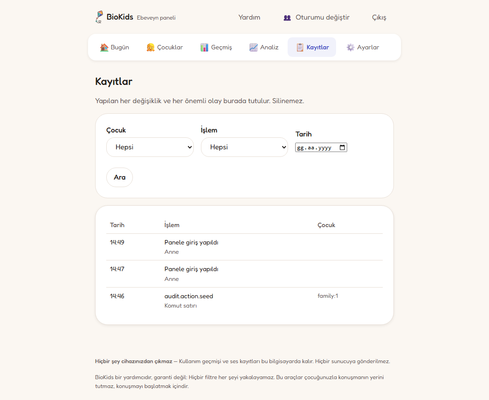

<p align="center"></p>

# BioKids

**Parental controls for Debian, for children aged 4–10, that run entirely on your own
machine.**

*Çocuklar için, tamamen kendi bilgisayarınızda çalışan ebeveyn denetimi.*

Guides, installation and support: **[biokids.bilalgurkansanli.com](https://biokids.bilalgurkansanli.com)**

BioKids turns a Debian 13 computer into one a young child can use on their own: they
log in by choosing their picture, land in a launcher of big tiles instead of a desktop,
and are told — out loud — when their time is nearly up. The parent sets the rules from
a panel on the same computer or on their phone. Time is counted in a way a changed
clock cannot cheat, harmful sites are closed for the children's accounts only, and
nothing about the family leaves the machine. It ships as Debian packages; the control
part is called BioGuard in the documentation.

> **BioKids 2.0.0.** The packages build, pass lintian, install, upgrade and purge on
> Debian 13, and the ISO installs beside Windows: it was tried in VirtualBox (BIOS and
> UEFI) and on the owner's own computer. The APT repository is not published yet; see
> [Install](#install) and [`docs/ROADMAP.md`](docs/ROADMAP.md).

---

## Principles

- **Nothing leaves the device.** No telemetry, analytics, crash reporting or account.
- **The child knows.** Supervision is visible, and the child is told what their family
  can see. Never covert.
- **Fail safe, not silent.** If the daemon, the filter or a lock fails, the child's
  session locks and the parent is told.
- **Never brick the machine.** BioKids changes nothing that could lock a parent out of
  their own computer; the bootloader and the firmware are left to them.
- **Offline first.** Everything core works with the network cable unplugged.
- **A parent can understand it** without knowing what DNS is.

The full text is in [`CLAUDE.md`](CLAUDE.md) §2.

---

## What it does

- **Time limits** that a child cannot cheat by changing the clock: daily quotas,
  allowed hours, separate weekday and weekend rules, and any day of the week with its
  own. Warnings at 10, 5 and 1 minute are **spoken** by Zio and Sio — espeak-ng out of
  the box, a natural Piper voice one button away in the panel, or the parent's own
  recorded voice — and shown in front of whatever app is open. Then the screen locks,
  counts down, and the computer shuts down (or only locks, or logs out: the parent
  chooses).
- **Breaks and earned time.** Optional forced breaks, with a few moves and rest for the
  eyes; time in learning apps can earn extra game time, at a ratio the parent sets; and,
  if the parent wants, games open only after the day's learning.
- **A gentle end.** Once a day, as the time runs out, the child may ask for a last round
  to finish what they are doing; and the screens that end the time suggest something to
  do away from the screen.
- **Limits per kind of app**: at most so many minutes of games, learning, web or other
  apps a day, inside the day's time.
- **A child launcher** instead of a desktop: big tiles for the apps and sites the parent
  chose, a ring with the minutes left, the same big buttons over every app (home, the
  app's own volume, and a close that works even on an app that will not close), no
  desktop, no settings, no terminal. Two age bands; for children who cannot read yet,
  tiles and screens read themselves aloud.
- **Login by picture.** Each child is their own picture on a BioKids login screen; no
  password to remember.
- **Filtering.** The internet is open with adult, gambling, malware and scam sites
  always closed — by a DNS filter on the machine (dnsmasq and nftables) that applies to
  the children's accounts only — or a child can be switched to "only the sites I
  choose". SafeSearch is forced. A managed Chromium policy closes what a browser could
  open around it, and the BioKids browser extension turns a closed site into a friendly
  page with a **"Büyüğüme sor" (ask a grown-up)** button.
- **Ask a grown-up.** More time, a site or an app: the request reaches the parent's
  phone and is answered in one tap, and the child is told the answer.
- **A parent panel** in the computer's applications menu, and on the parent's phone
  over their own private network: one button installs and signs in Tailscale. No
  BioKids account, no cloud, no port forwarding.
- **History**: two weeks of minutes, and for any day the apps, the sites opened (by
  name only) and the requests. Plus an **audit log** of every rule change, PIN attempt,
  grant and clock change.
- **Recorded parent voices.** A parent can record the seven spoken lines on their phone,
  and the child hears them in that voice.
- **The warm side of the panel.** "Aferin!" in one tap or a short note to the child's
  screen; "Birlikteyiz" while a parent plays with the child, when nothing is counted;
  a few things to talk about in the evening, from the child's day; and the child can
  send a recording of their own from **Sesim**.
- **Learning to read.** The reading corner teaches Turkish reading in first grade's
  order, five sound groups from letters to sentences, beside the English corner.
- **Peace of mind.** A protection list that shows what is in place and what to do where
  something is not, a preview of the child's screen, and an encrypted backup to move
  everything to a new computer.
- **Optional: "Sor Bana", a local assistant.** A child types or, if allowed, says a
  question and gets an answer for their age from a language model running on the
  machine, checked against an offline encyclopedia. It refuses what a child should not
  ask, and the parent sees what it refused. Off by default.
- **Optional: offline Wikipedia** as a tile for 8–10 year olds, once the parent has
  downloaded it with the assistant.

### The parent panel


One card per child and nothing else. A parent glancing at this on their phone has to
understand it in three seconds without reading a label twice, so it is a ring, one line
of state, and **+10 dk**, **Kilitle**, **Kapat**. Everything else is one level down.


A few visible controls. Breaks, earned time, different days and limits per kind of app
live behind *Gelişmiş*, because most parents never touch them and a screen of thirty
inputs is a screen nobody finishes.



Every rule change, every PIN attempt, every warning spoken and every time the system
clock moved. Nothing edits an entry; entries older than a year are deleted.

---

## Requirements

- **Debian 13 "trixie", amd64.**
- **An X11 session.** Wayland is not supported (D-12). `biokids-desktop` brings Xfce
  and LightDM, which is the tested setup.
- **4 GB of memory** and about 25 GB of disk. The optional assistant needs 7 GB or more.
- A network connection only to install. Afterwards everything core works offline.

---

## Install

> **Not published yet.** Releases go to the project's own APT repository,
> `https://apt.biokids.bilalgurkansanli.com`, built by the release workflow and signed
> with a key that exists only in GitHub Secrets. That key has not been generated yet,
> so there is no repository to add and no fingerprint to check; both arrive with the
> v2.0.0 release, and the fingerprint will be printed here. Until then the packages are
> built from this repository: [`docs/VM-RUNBOOK.md`](docs/VM-RUNBOOK.md) §1.

Once it is published, on an existing Debian 13 system:

```bash
curl -fsSL https://apt.biokids.bilalgurkansanli.com/KEY.gpg \
  | sudo tee /usr/share/keyrings/biokids-archive-keyring.gpg > /dev/null

echo "deb [signed-by=/usr/share/keyrings/biokids-archive-keyring.gpg] \
https://apt.biokids.bilalgurkansanli.com trixie main" \
  | sudo tee /etc/apt/sources.list.d/biokids.list

sudo apt update && sudo apt install biokids-desktop
```

`biokids-desktop` is the whole child setup: BioKids, Xfce, LightDM and the application
catalogue. `biokids` alone installs BioKids on a desktop you already have. The
assistant is a separate package, `biokids-ai`, never installed by default. `biokids`
recommends `biokids-archive-keyring`, the package that ships the same key file.

A bootable image - Debian 13 with BioKids, its apps and the assistant's runtime,
which installs itself beside Windows if you want - is built from [`iso/`](iso/README.md),
and published with each release; [`iso/README.md`](iso/README.md) has the steps for a
computer that has Windows.

## First steps

1. **The setup wizard** opens by itself in your browser as soon as the packages are
   installed, and again at each login until setup is complete. Nine steps, each
   skippable: language, your PIN, a passphrase and recovery code, the first child,
   their apps, their time, their internet, phone access (four guided steps with
   QR codes), and Zio and Sio.
2. **Restart once**, so the login screen shows the child's picture. The panel's first
   page has a button for it until you do.
3. **The child logs in** by choosing their picture. The first time, the launcher
   explains — in words and out loud for the youngest — what Zio and Sio do and what the
   family can see.
4. **The panel** is the "BioKids Ebeveyn Paneli" icon on your desktop and in the
   applications menu, and on your phone once phone access is on (**Ayarlar**). Mail
   notifications are set up there too. **Yardım** answers the common questions.

---

## Privacy

**Nothing leaves your device.** No telemetry, no analytics, no crash reporting, no
account. The list of outbound connections BioKids makes is short, most of it optional,
and complete in [`docs/SECURITY.md`](docs/SECURITY.md#4-outbound-network-inventory):
Debian and BioKids updates, DNS, and only what the parent switches on — their own mail
server, Tailscale, the assistant's one-time download, and the natural voice's (Piper
from GitHub, its Turkish voice from Hugging Face, each checked against a pinned
checksum).

- The browser extension tells the child's own launcher the **name** of each site
  opened — never the page, the search, or anything typed — and the child is told so.
- Voice recordings and the assistant's models stay on the computer; an ordinary
  question to the assistant is answered and forgotten.
- Records are deleted on a schedule: sites and alerts after 30 days, requests after
  90, the audit log after a year, daily minutes after 400 days
  (`/etc/biokids/config.toml`, `[retention]`).

---

## What it does not do

BioKids is built for a **curious child aged 4 to 10, working alone on one computer.**

It will not stop someone who boots from a USB stick, edits the kernel command line,
removes the drive, or has an adult helping them. It does not protect phones or tablets.
It is a supervision aid, not a guarantee — no filter catches everything, and none of
this replaces talking to your child.

The full list of what is in and out of scope is in
[`docs/SECURITY.md`](docs/SECURITY.md#1-threat-model). We would rather be honest about
the limits than let a parent feel safer than they are.

---

## How it fits together

```
  parent's phone ──(tailscale serve)──▶  biokids-panel   ─┐
                                          127.0.0.1:7878  │  /run/biokids/daemon.sock
                                                          ▼
                                                    biokids-daemon        (root)
                                                    · BOOTTIME ledger
                                                    · policy engine
                                                    · logind watcher
                                                    · DNS filter, browser policy
                                                          ▲
                                    127.0.0.1:7879+uid%100 │  /run/biokids/shell.sock
  the child      ──────────────────────▶  biokids-shell  ─┘   (authorised by peer uid)
                    kiosk Chromium        biokids-voice
                    + BioKids extension
```

The daemon is the only component allowed to change system state; everything else asks
it. The panel and the launcher reach it over two different sockets with two very
different sets of permissions — the child's session cannot grant time, unlock a screen
or reach a sibling's data. [`docs/ARCHITECTURE.md`](docs/ARCHITECTURE.md) has the
detail.

Three things carry most of the correctness:

- **Time accounting never touches the wall clock.** Every interval is a difference of
  two `CLOCK_BOOTTIME` readings, minus the part the machine spent suspended — which is
  derived by comparing `BOOTTIME` with `MONOTONIC` rather than trusted from anywhere.
  Moving the system clock three hours forward changes nothing, and says so in the audit
  log.
- **The policy engine is a pure function.** `(policy, ledger, activity, now) → decision`,
  with no I/O and no clock access, so every rule about a child's day is tested without a
  machine.
- **Enforcement failures lock; convenience failures degrade.** If the daemon dies the
  child's session is locked and the parent is told. If the voice service dies the child
  reads the warning instead of hearing it.

---

## Development

Python 3.13, FastAPI, SQLite; Jinja2 and hand-written CSS with no build step. Run it
from a checkout:

```bash
python3 -m venv .venv && . .venv/bin/activate
pip install -e ".[dev,daemon]"

python dev/seed.py                 # a family, two children, the app catalogue
python -m biokids_daemon           # as root, or --no-logind to develop without one
python -m biokids_panel            # http://127.0.0.1:7878
```

`pytest` runs the suite; `ruff` and `mypy --strict` (core and daemon) are what CI
checks. `dev/fakeclock.py` drives the ledger with an injected clock, so a three-hour
session takes three seconds and the whole end-of-time sequence is visible in one screen
of output:

```
         sim     wall     used     left  what  reason             note
 ! + 0:02:10 16:02:10  0:02:00  0:10:00  WARN  quota.warning      speaks warn_10: "On dakikan kaldı."
 ! + 0:11:10 16:11:10  0:11:00  0:01:00  WARN  quota.warning      speaks warn_1: "Bir dakikan kaldı Elif."
!! + 0:12:10 16:12:10  0:12:00  0:00:00  LOCK  quota.exhausted    screen locked, 120 s countdown starts
!! + 0:14:10 16:14:10  0:12:00  0:00:00  END   quota.exhausted    countdown expired -> poweroff
```

Anything touching boot, PAM, nftables or GRUB is developed in a Debian 13 VM;
[`CONTRIBUTING.md`](CONTRIBUTING.md) has the workflow and
[`docs/VM-RUNBOOK.md`](docs/VM-RUNBOOK.md) builds, installs and checks the packages
step by step.

| | |
|---|---|
| [`CLAUDE.md`](CLAUDE.md) | project constitution and conventions |
| [`docs/ARCHITECTURE.md`](docs/ARCHITECTURE.md) | components, time engine, policy engine, data model |
| [`docs/DECISIONS.md`](docs/DECISIONS.md) | every design decision and why |
| [`docs/ROADMAP.md`](docs/ROADMAP.md) | what was built, what was cut, what comes next |
| [`docs/SECURITY.md`](docs/SECURITY.md) | threat model, privileges, filtering internals |
| [`docs/UX.md`](docs/UX.md) | design tokens and interface rules |
| [`docs/VOICE.md`](docs/VOICE.md) | Zio and Sio |
| [`docs/AI-LAYER.md`](docs/AI-LAYER.md) | the optional assistant |
| [`docs/PACKAGING.md`](docs/PACKAGING.md) | packages, APT repository, ISO, CI |
| [`docs/VM-RUNBOOK.md`](docs/VM-RUNBOOK.md) | building and checking the packages on a VM |
| [`CHANGELOG.md`](CHANGELOG.md) | what changed, release by release |

Contributions are welcome. Please read [`CONTRIBUTING.md`](CONTRIBUTING.md) first — it
includes the list of features this project will **not** accept, such as covert
monitoring, keystroke logging, and any view of a child's screen the child is not shown
or that is kept.

---

## License

MIT. See [`LICENSE`](LICENSE).

Built under the [BioStudio](https://bilalgurkansanli.com) label by Bilal Gürkan Şanlı.
