<div align="center">

[English](README.md) · **Türkçe**

<br>

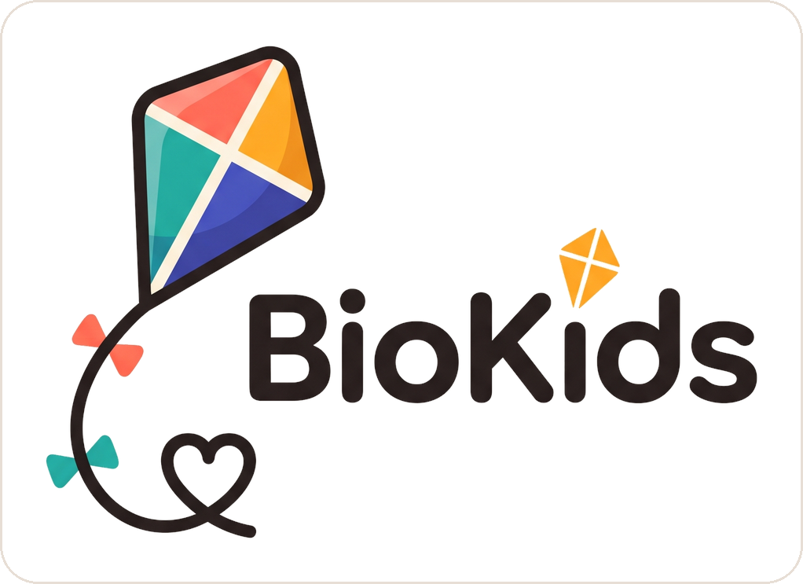

### Tamamen kendi bilgisayarınızda çalışan, Debian için ebeveyn denetimi

4–10 yaş çocuklar için · hesap yok · bulut yok · hiçbir şey cihazdan çıkmaz

[](https://github.com/bilalgurkansanli/BioKids/actions/workflows/ci.yml)
[](https://github.com/bilalgurkansanli/BioKids/releases)
[](LICENSE)
[](https://www.debian.org/releases/trixie/)
[](pyproject.toml)

**[Web sitesi](https://biokids.bilalgurkansanli.com)** ·
**[İndir](#i̇ndir)** ·
**[Rehberler ve destek](https://biokids.bilalgurkansanli.com)** ·
**[Belgeler](#belgeler)** ·
**[Katkıda bulunun](CONTRIBUTING.md)**

<br>

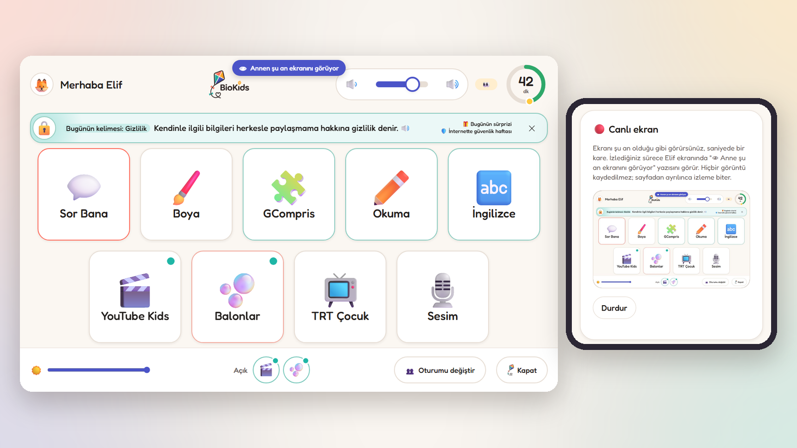

<sub>Çocuğun ekranı ve onu telefondan canlı izleyen ebeveyn. Çocuk bunu görür.</sub>

</div>

---

BioKids, Debian 13 yüklü bir bilgisayarı küçük bir çocuğun tek başına
kullanabileceği hale getirir. Çocuk resmine dokunarak giriş yapar, masaüstü yerine
kocaman kutulardan oluşan bir başlatıcıya gelir ve süresi bitmek üzereyken bu ona sesli
olarak söylenir. Kuralları ebeveyn koyar: aynı bilgisayardaki ya da telefonundaki
panelden. Süre, saati değiştirerek kandırılamayacak biçimde sayılır; zararlı siteler
yalnızca çocukların hesaplarında kapanır ve **aileyle ilgili hiçbir şey bilgisayardan
dışarı çıkmaz.**

Kurulmaya hazır bir ISO olarak gelir (BioKids yüklü Debian 13; isterseniz Windows'un
yanına kurulur). Zaten Debian kullanan bir bilgisayar için Debian paketleri de vardır.

> **BioKids 2.0.0.** Paketler derleniyor, lintian'dan geçiyor ve Debian 13'te
> kurulup, güncellenip, tamamen kaldırılabiliyor. ISO, VirtualBox'ta (BIOS ve UEFI) ve
> gerçek bir bilgisayarda Windows'un yanına kuruldu. Sırada ne olduğu
> [`docs/ROADMAP.md`](docs/ROADMAP.md) dosyasında.

## Neden BioKids

<table>
<tr>
<td width="50%" valign="top">

**🏠 Evde kalır.** Telemetri yok, analiz yok, hesap yok, bulut yok. Panel telefonunuza
kendi özel ağınız üzerinden ulaşır, hiçbir zaman bir BioKids sunucusundan geçmez;
zaten bir BioKids sunucusu yok.

</td>
<td width="50%" valign="top">

**👀 Çocuk bilir.** Denetim her zaman görünür. İlk açılışta ailenin neleri
görebileceği anlatılır; bir ebeveyn ekranı izlerken çocuk bunu ekranında görür.

</td>
</tr>
<tr>
<td valign="top">

**🤖 Bilgisayarda çalışan bir asistan.** *Sor Bana*, çocuğun sorularını bilgisayarın
kendisinde çalışan bir dil modeliyle yanıtlar. Hiçbir soru buluta gitmez.

</td>
<td valign="top">

**📱 Kumanda telefonunuz.** On dakika daha verin, ekranı kilitleyin, bir isteği
yanıtlayın ya da ekranı canlı izleyin: her yerden, kendi özel ağınız üzerinden.

</td>
</tr>
<tr>
<td valign="top">

**⏱️ Kandırılamayan süre.** Dakikalar çekirdeğin açılıştan beri işleyen saatiyle
sayılır; sistem saatini ileri almak hiçbir şeyi değiştirmez ve bu değişiklik kayıtlara
yazılır.

</td>
<td valign="top">

**🧸 4–10 yaş için yapıldı.** Kocaman kutular, kalan süreyi gösteren bir halka, henüz
okuma bilmeyen çocuklar için kendini sesli okuyan düğmeler ve neler olduğunu anlatan iki
arkadaş: Zio ve Sio.

</td>
</tr>
</table>

## Sor Bana: bilgisayardan hiç çıkmayan bir asistan

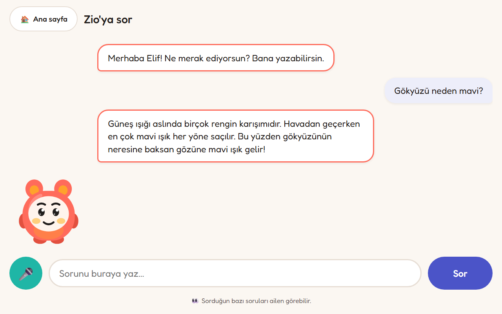

Çocuk sorusunu yazar ya da ebeveyn mikrofona izin verdiyse sesli sorar; yaşına uygun
bir yanıtı, sorduğu dilde alır. Yanıt **bilgisayarın kendisinde** çalışan bir dil
modelinden gelir (llama.cpp ile Gemma, konuşma için Whisper) ve çevrimdışı bir
Vikipedi ile karşılaştırılır. Hiçbir yere bir şey gönderilmez: sıradan bir soru
yanıtlanır ve unutulur.

Bir çocuğun sormaması gerekenleri reddeder; ebeveyn neleri reddettiğini görür. Ayrı bir
pakettir ve ebeveyn onu panelden indirip (ilerleme çubuğuyla) bir çocuk için açana
kadar kapalıdır; 7 GB ya da daha fazla bellek ister. İngilizce köşesinde Sio aynı
modelle çocukla basit İngilizce sohbet eder.

## Ekran, canlı olarak telefonunuzda

<table>
<tr>
<td width="58%" valign="top">

Panelde (bilgisayarın başında ya da her yerden telefonunuzda) **Canlı izle**'ye
basarsınız ve çocuğunuzun ekranını o anki haliyle, saniyede yaklaşık bir kare olarak
görürsünüz.

- **Çocuğa söylenir.** Siz izlerken başlatıcıda ve her uygulamanın üstündeki çubukta
  *"👁 Annen şu an ekranını görüyor"* yazar. Bu işaret kapatılamaz.
- **Hiçbir şey kaydedilmez.** Her kare bellekte bir öncekinin yerini alır, hiçbir yere
  yazılmaz. Sayfadan ayrılınca izleme biter.
- **Ailede herkes bunun olduğunu görebilir.** Her izleme başlangıcı kayıtlara geçer.

BioKids'in bir çocuğun ekranına baktığı tek an budur ve yalnızca bir ebeveyn izlerken
olur.

</td>
<td width="42%" valign="top">

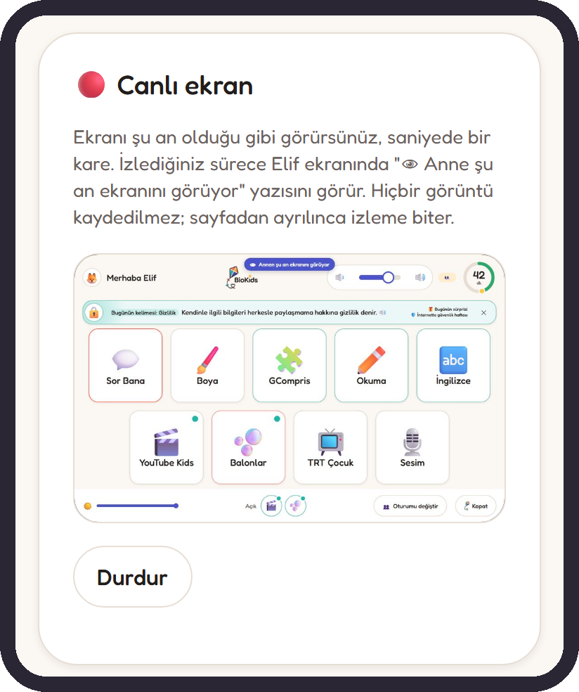

</td>
</tr>
</table>

## Diğer ekranlar

<table>
<tr>
<td width="50%">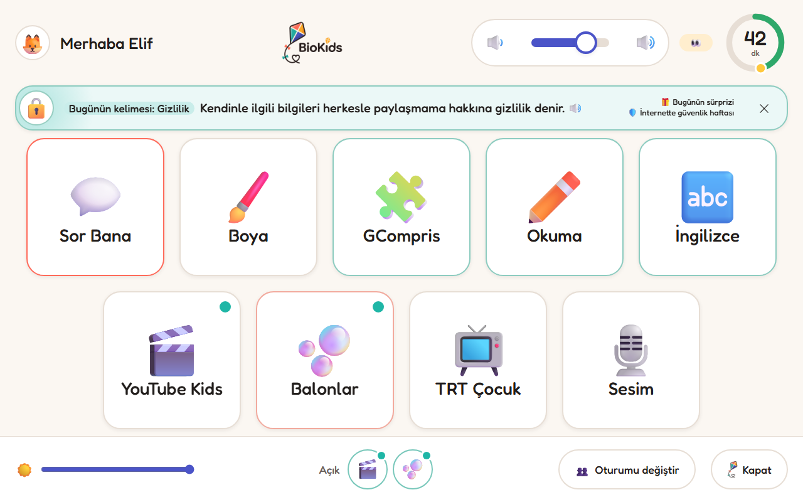</td>
<td width="50%">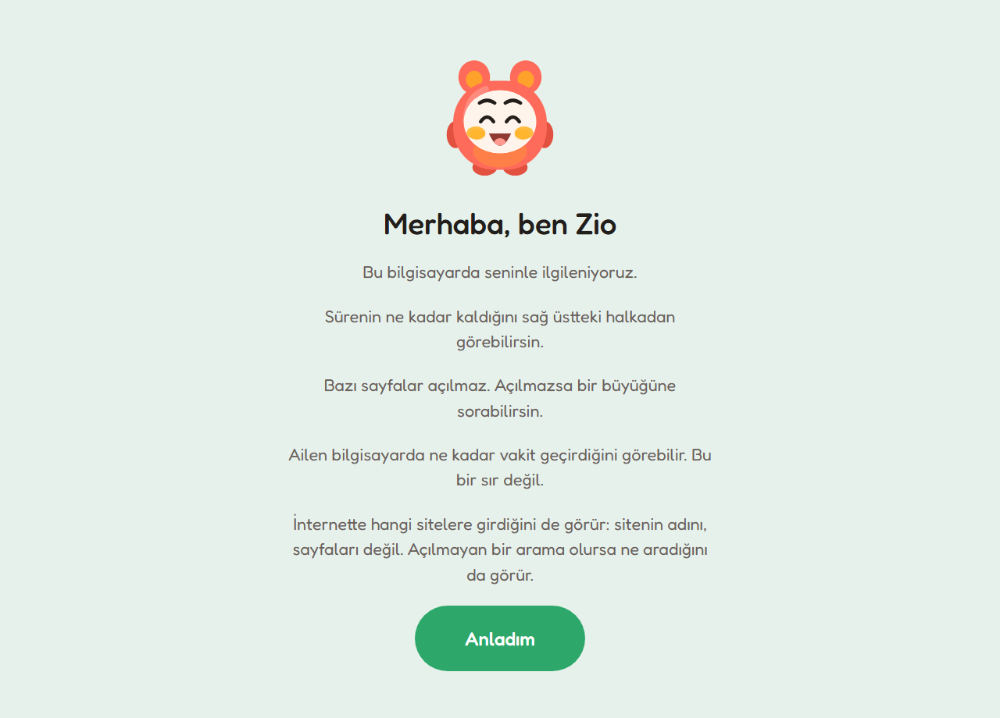</td>
</tr>
<tr>
<td align="center"><b>Başlatıcı.</b> Ebeveynin seçtiği uygulamalar, kalan dakikalar ve açık olanlar.</td>
<td align="center"><b>İlk açılış.</b> Zio çocuğa ailenin neleri görebileceğini anlatır.</td>
</tr>
<tr>
<td>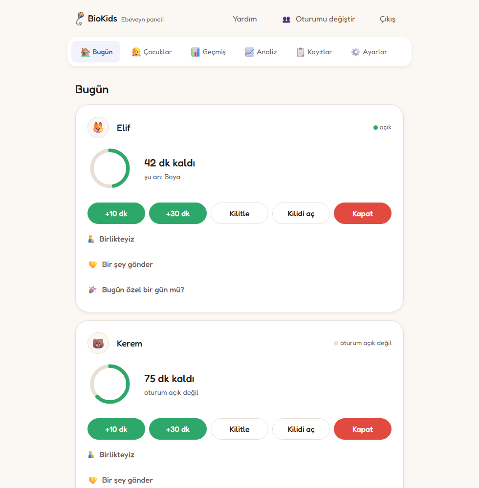</td>
<td>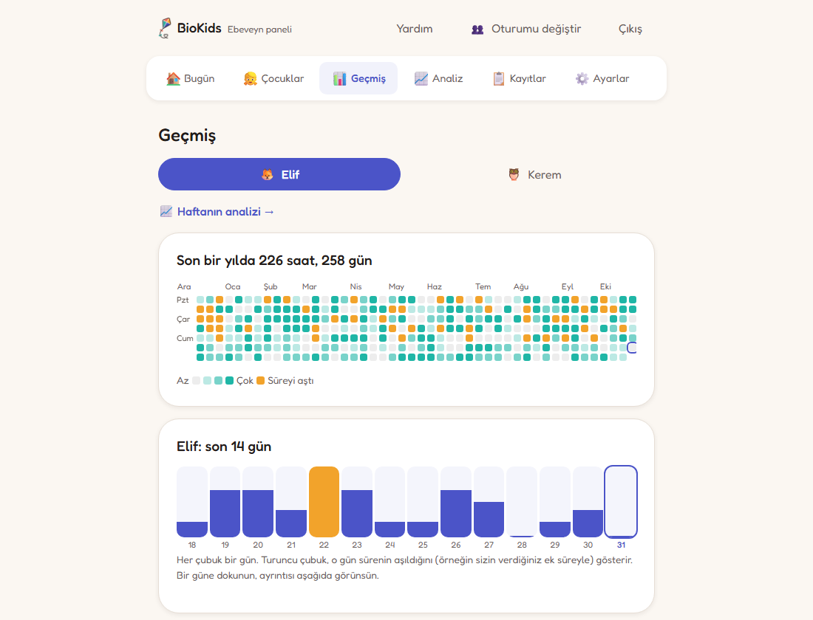</td>
</tr>
<tr>
<td align="center"><b>Bugün.</b> Her çocuğa bir kart: kalan süre, ekranda ne olduğu, +10 dk, kilitle, kapat.</td>
<td align="center"><b>Geçmiş.</b> Bir bakışta bir yıl, son iki hafta ve herhangi bir günün ayrıntısı.</td>
</tr>
<tr>
<td>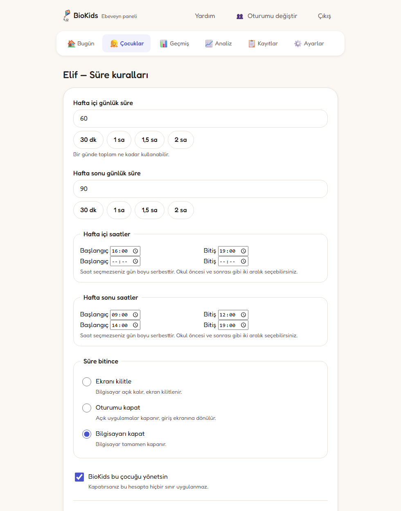</td>
<td>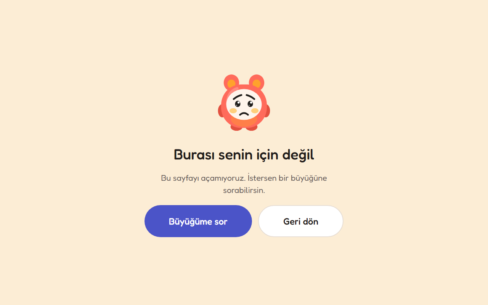</td>
</tr>
<tr>
<td align="center"><b>Süre kuralları.</b> Birkaç anlaşılır ayar; gerisi <i>Gelişmiş</i>'in arkasında.</td>
<td align="center"><b>Kapalı bir site</b>, <i>Büyüğüme sor</i> düğmesi olan sevimli bir sayfadır.</td>
</tr>
</table>

## Özellikler

### Çocuk için

- **Masaüstü yerine bir başlatıcı.** Ebeveynin seçtiği uygulamalar ve siteler için
  kocaman kutular, kalan dakikaları gösteren bir halka ve her uygulamanın üstünde aynı
  düğmeler: ana sayfa, uygulamanın kendi ses ayarı, küçük açılan uygulamalar için tam
  ekran düğmesi ve kapanmak bilmeyen bir uygulamayı bile kapatan bir kapat düğmesi.
  Masaüstü yok, ayarlar yok, terminal yok.
- **Baştan başlamadan geçiş.** Açık uygulamalar ve siteler başlatıcının altında bekler:
  videoyu durdurur, oyun oynar ve videoya kaldığı yerden döner.
- **Resimle giriş**, iki yaş grubu (4–7 ve 8–10) ve henüz okuma bilmeyen çocuklar için
  kendini sesli okuyan kutular ve ekranlar.
- **Zio ve Sio**, bir anne ve bir baba sesi, 10, 5 ve 1 dakika kala uyarıları söyler:
  kutudan çıktığı haliyle espeak-ng, bir düğmeyle Piper'ın doğal sesi ya da ebeveynin
  kendi kaydettiği ses.
- **Öğrenme köşeleri.** Birinci sınıfın sırasıyla, harflerden cümlelere Türkçe okuma ve
  Sio ile bir İngilizce köşesi.
- **Büyüğüme sor.** Biraz daha süre, bir site ya da bir uygulama: istek ebeveynin
  telefonuna gider, tek dokunuşla yanıtlanır ve çocuğa yanıt söylenir.
- **Sesim**: çocuk ebeveynine kendi ses kaydını gönderebilir.

### Ebeveyn için

- **Süre sınırları**: günlük kotalar, izin verilen saatler; hafta içi, hafta sonu ya da
  her güne ayrı kurallar. Süre bitince ekran kilitlenir, geri sayar ve bilgisayar
  kapanır; ya da yalnızca kilitlenir veya oturum kapanır: seçim ebeveynin.
- **Molalar ve kazanılan süre.** İsteğe bağlı zorunlu molalar ve gözler için birkaç
  hareket; öğrenme uygulamaları ek oyun süresi kazandırabilir; oyunlar günün öğrenmesi
  bitene kadar bekleyebilir; uygulama türüne göre sınırlar (oyun, öğrenme, internet).
- **Yumuşak bir bitiş.** Çocuk günde bir kez, yaptığı işi bitirmek için son bir tur
  isteyebilir; süre bitiş ekranları ekrandan uzakta yapılacak bir şey önerir.
- **Panel**, uygulamalar menüsünde ve ebeveynin kendi özel ağı üzerinden telefonunda
  (Tailscale, tek düğmeyle kurulur; port yönlendirme asla yok). E-posta bildirimleri
  ebeveynin kendi posta sunucusundan gider.
- **Canlı ekran**: [yukarıda](#ekran-canlı-olarak-telefonunuzda).
- **Geçmiş ve kayıtlar.** İki haftanın dakikaları ayrıntılı, bir yıl harita olarak; her
  kural değişikliği, PIN denemesi, verilen süre ve saat değişikliği kayıtlarda.
- **Sıcak taraf.** Tek dokunuşla "Aferin!" ya da çocuğun ekranına kısa bir not;
  birlikte oynarken hiçbir şeyin sayılmadığı "Birlikteyiz"; çocuğun gününden akşam
  konuşmak için birkaç konu.
- **İç rahatlığı.** Nelerin yerinde olduğunu ve olmayan bir şey için ne yapılacağını
  söyleyen bir koruma listesi ve her şeyi yeni bir bilgisayara taşımak için şifreli bir
  yedek.

### Filtreleme

- **İnternet açık, en kötüleri kapalı**: yetişkin, kumar, zararlı yazılım ve
  dolandırıcılık siteleri, bilgisayardaki bir DNS filtresiyle (dnsmasq ve nftables)
  yalnızca çocukların hesaplarında kapanır. İstenirse bir çocuk *yalnızca seçtiğim
  siteler* moduna alınabilir.
- **SafeSearch zorunludur**, yönetilen bir Chromium ilkesi tarayıcının çevresinden
  açılabilecekleri kapatır ve BioKids eklentisi kapalı bir siteyi sevimli bir sayfaya
  çevirir.
- **Araya giren bir vekil sunucu yok**: BioKids hiç kimsenin trafiğinin şifresini
  çözmez.

### İsteğe bağlı

- **Sor Bana**, bilgisayardaki asistan: [yukarıda](#sor-bana-bilgisayardan-hiç-çıkmayan-bir-asistan).
- 8–10 yaş için bir kutu olarak **çevrimdışı Vikipedi**; asistanla birlikte indirilir.

## İndir

### ISO: yeni ya da boşta duran bir bilgisayar için

Kalıp; Xfce, BioKids, çocukların uygulamaları ve asistanın çalışma ortamıyla birlikte
Debian 13'tür. Denemek için canlı sistem olarak açılır ve Debian'ın kendi kurulum
programıyla, BioKids görünümünde ve ağ gerekmeden kurulur. Windows olan bir
bilgisayarda kurulum, Windows'u küçültüp yanına kurmayı önerir; açılış menüsünde ikisi
de görünür.

1. ISO'yu [son sürümden](https://github.com/bilalgurkansanli/BioKids/releases) indirin.
   2 GB'tan büyük olduğu için sürüm sayfası archive.org'daki kopyasına ve SHA256
   değerine bağlantı verir.
2. 8 GB ya da daha büyük bir USB belleğe yazın (balenaEtcher, DD modunda Rufus ya da
   `dd`).
3. Bilgisayarı USB bellekten açın ve **Start installer**'ı seçin.

Windows olan bir bilgisayar için adımlar ve kalıbın nasıl derlendiği
[`iso/README.md`](iso/README.md) dosyasında.

### Paketler: Debian 13 yüklü bir bilgisayarda

Sürümler projenin kendi APT deposuna, `https://apt.biokids.bilalgurkansanli.com`
adresine gider ve BioKids arşiv anahtarıyla imzalanır:

```
F6A4 D652 8690 1EE0 99A1  095A 793E 458A 5F17 E9B0
```

```bash
curl -fsSL https://apt.biokids.bilalgurkansanli.com/KEY.gpg \
  | sudo tee /usr/share/keyrings/biokids-archive-keyring.gpg > /dev/null

echo "deb [signed-by=/usr/share/keyrings/biokids-archive-keyring.gpg] \
https://apt.biokids.bilalgurkansanli.com trixie main" \
  | sudo tee /etc/apt/sources.list.d/biokids.list

sudo apt update && sudo apt install biokids-desktop
```

`apt install`'dan önce `gpg --show-keys /usr/share/keyrings/biokids-archive-keyring.gpg`
yukarıdaki parmak izini yazmalı; yazmıyorsa anahtar bizim değildir. Paketleri kendiniz
derlemek için: [`docs/VM-RUNBOOK.md`](docs/VM-RUNBOOK.md) §1.

`biokids-desktop` çocuk kurulumunun tamamıdır: BioKids, Xfce, LightDM ve uygulama
kataloğu. Yalnızca `biokids`, BioKids'i var olan masaüstünüze kurar. Asistan ayrı bir
pakettir (`biokids-ai`) ve hiçbir zaman kendiliğinden kurulmaz.

### Gereksinimler

| | |
|---|---|
| Sistem | Debian 13 "trixie", amd64 |
| Oturum | X11 (Wayland desteklenmiyor, D-12); `biokids-desktop` Xfce ve LightDM'i getirir |
| Bellek | 4 GB; isteğe bağlı asistan için 7 GB ya da daha fazla |
| Disk | yaklaşık 25 GB |
| Ağ | yalnızca kurulum için; sonrasında temel her şey çevrimdışı çalışır |

## İlk adımlar

1. **Kurulum sihirbazı**, BioKids kurulur kurulmaz kendiliğinden açılır ve kurulum
   tamamlanana kadar her girişte yeniden açılır. Her biri atlanabilen dokuz kısa adım:
   dil, PIN'iniz, bir parola ve kurtarma kodu, ilk çocuk, uygulamaları, süresi,
   interneti, telefondan erişim (QR kodlu dört adım) ve Zio ile Sio.
2. Giriş ekranında çocuğun resminin görünmesi için **bir kez yeniden başlatın**.
3. **Çocuk resmine dokunarak giriş yapar.** İlk seferde başlatıcı, en küçükler için
   sesli olarak da, Zio ile Sio'nun ne yaptığını ve ailenin neleri görebileceğini
   anlatır.
4. **Panel**, masaüstünüzdeki ve uygulamalar menüsündeki "BioKids Ebeveyn Paneli"
   simgesidir; telefondan erişimi açtığınızda telefonunuzda da. Sık sorulan soruların
   yanıtları **Yardım**'da, rehberler [web sitesinde](https://biokids.bilalgurkansanli.com).

## Gizlilik

**Hiçbir şey cihazınızdan çıkmaz.** BioKids'in yaptığı dış bağlantıların listesi kısa,
çoğu isteğe bağlı ve tamamı
[`docs/SECURITY.md`](docs/SECURITY.md#4-outbound-network-inventory) dosyasında: Debian
ve BioKids güncellemeleri, DNS ve yalnızca ebeveynin açtıkları; kendi posta sunucusu,
Tailscale ve kendi başlattığı indirmeler (asistanın modelleri, doğal ses, çevrimdışı
Vikipedi). Her indirme sabitlenmiş bir sağlama toplamıyla denetlenir.

- Tarayıcı eklentisi, çocuğun kendi başlatıcısına açılan her sitenin yalnızca **adını**
  söyler; sayfayı, aramayı ya da yazılan hiçbir şeyi söylemez. Bu, çocuğa da anlatılır.
- Hiçbir ekran kaydedilmez. Tek canlı izleme ebeveynindir; sürdüğü boyunca çocuğa
  gösterilir ve hiçbir yerde saklanmaz.
- Ses kayıtları ve asistanın modelleri bilgisayarda kalır.
- Kayıtlar bir takvime göre silinir: siteler ve uyarılar 30 gün, istekler 90 gün,
  kayıt defteri bir yıl, günlük dakikalar 400 gün sonra.

## Neler yapmaz

BioKids **tek bir bilgisayarda tek başına çalışan, 4–10 yaşında meraklı bir çocuk**
için yapıldı. USB bellekten açan, çekirdek komut satırını değiştiren, diski söken ya da
yanında ona yardım eden bir yetişkin olan birini durdurmaz. Telefonları ve tabletleri
korumaz. Bir denetim yardımcısıdır, bir garanti değildir: hiçbir filtre her şeyi
yakalamaz ve bunların hiçbiri çocuğunuzla konuşmanın yerini tutmaz.

Kapsamın içinde ve dışında kalanların tamamı
[`docs/SECURITY.md`](docs/SECURITY.md#1-threat-model) dosyasında. Bir ebeveynin
kendini olduğundan daha güvende hissetmesindense sınırlar konusunda dürüst olmayı
tercih ediyoruz.

## Nasıl çalışır

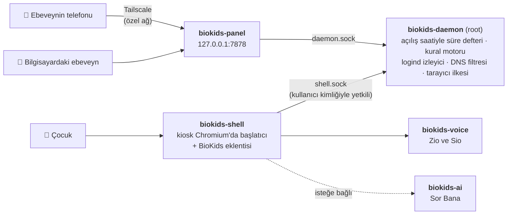

Sistemin durumunu değiştirmesine izin verilen tek bileşen arka plan hizmetidir
(daemon); geri kalan her şey ondan ister. Panel ve başlatıcı ona, çok farklı yetkileri
olan iki ayrı soketten ulaşır: bir çocuğun oturumu süre veremez, bir ekranın kilidini
açamaz ya da kardeşinin verilerine ulaşamaz. Doğruluğun büyük kısmını üç şey taşır:

- **Süre hesabı duvar saatine hiç dokunmaz.** Her aralık iki `CLOCK_BOOTTIME`
  okumasının farkıdır; bilgisayarın uykuda geçirdiği süre, bir yerden alınıp
  güvenilmek yerine `BOOTTIME` ile `MONOTONIC` karşılaştırılarak çıkarılır.
- **Kural motoru saf bir fonksiyondur.** `(kurallar, defter, etkinlik, şimdi) → karar`;
  hiçbir giriş-çıkış ve saat erişimi yoktur, böylece bir çocuğun günüyle ilgili her
  kural bir bilgisayar olmadan test edilir.
- **Denetim hataları kilitler; kolaylık hataları yalnızca eksiltir.** Arka plan hizmeti
  çökerse çocuğun oturumu kilitlenir ve ebeveyne haber verilir. Ses hizmeti çökerse
  çocuk uyarıyı duymak yerine okur.

Ayrıntılar [`docs/ARCHITECTURE.md`](docs/ARCHITECTURE.md) dosyasında.

## Geliştirme

Python 3.13, FastAPI ve SQLite; Jinja2 ve elle yazılmış CSS. Derleme adımı, npm ve
çatı (framework) yok. Bir kopyadan:

```bash
python3 -m venv .venv && . .venv/bin/activate
pip install -e ".[dev,daemon]"

python dev/seed.py                 # bir aile, iki çocuk, uygulama kataloğu
python -m biokids_daemon           # root olarak; ya da logind olmadan geliştirmek için --no-logind
python -m biokids_panel            # http://127.0.0.1:7878
```

`pytest` testleri çalıştırır; CI `ruff` ve `mypy --strict` ile denetler.
`dev/fakeclock.py` gerçek süre defterini sahte bir saatle sürer; böylece üç saatlik bir
oturum üç saniye sürer ve süre bitişinin tamamı tek ekrana sığar:

```
         sim     wall     used     left  what  reason             note
 ! + 0:02:10 16:02:10  0:02:00  0:10:00  WARN  quota.warning      speaks warn_10: "On dakikan kaldı."
 ! + 0:11:10 16:11:10  0:11:00  0:01:00  WARN  quota.warning      speaks warn_1: "Bir dakikan kaldı Elif."
!! + 0:12:10 16:12:10  0:12:00  0:00:00  LOCK  quota.exhausted    screen locked, 120 s countdown starts
!! + 0:14:10 16:14:10  0:12:00  0:00:00  END   quota.exhausted    countdown expired -> poweroff
```

Açılışa, PAM'e, nftables'a ya da GRUB'a dokunan her şey bir Debian 13 sanal makinesinde
geliştirilir. Çalışma düzeni [`CONTRIBUTING.md`](CONTRIBUTING.md) dosyasında;
paketlerin adım adım derlenip kurulması ve denetlenmesi
[`docs/VM-RUNBOOK.md`](docs/VM-RUNBOOK.md) dosyasında.

### Belgeler

Belgeler İngilizcedir.

| | |
|---|---|
| [`docs/ARCHITECTURE.md`](docs/ARCHITECTURE.md) | bileşenler, süre motoru, kural motoru, veri modeli |
| [`docs/SECURITY.md`](docs/SECURITY.md) | tehdit modeli, yetkiler, filtrelemenin içi, her dış bağlantı |
| [`docs/DECISIONS.md`](docs/DECISIONS.md) | her tasarım kararı ve nedeni |
| [`docs/UX.md`](docs/UX.md) | tasarım belirteçleri ve arayüz kuralları |
| [`docs/VOICE.md`](docs/VOICE.md) | Zio ve Sio |
| [`docs/AI-LAYER.md`](docs/AI-LAYER.md) | isteğe bağlı asistan |
| [`docs/PACKAGING.md`](docs/PACKAGING.md) | paketler, APT deposu, ISO, CI |
| [`docs/ROADMAP.md`](docs/ROADMAP.md) | neler yapıldı, nelerden vazgeçildi, sırada ne var |
| [`docs/VM-RUNBOOK.md`](docs/VM-RUNBOOK.md) | paketlerin sanal makinede derlenip denetlenmesi |
| [`CHANGELOG.md`](CHANGELOG.md) | sürüm sürüm neler değişti |
| [`CLAUDE.md`](CLAUDE.md) | projenin ilkeleri ve kuralları |

## Katkıda bulunun

Katkılarınızı bekliyoruz: hata bildirimleri, çeviriler, donanım raporları ve kod.
Lütfen önce [`CONTRIBUTING.md`](CONTRIBUTING.md) dosyasını okuyun: çalışma düzenini
anlatır ve bu projenin **kabul etmeyeceği** özellikleri sıralar; örneğin gizli izleme,
tuş kaydı ya da çocuğa gösterilmeyen veya saklanan herhangi bir ekran görüntüsü. Katılan
herkes [Davranış Kuralları](CODE_OF_CONDUCT.md)'na uyar.

Bir güvenlik sorunu mu buldunuz? Lütfen herkese açık bir issue olarak değil,
[`SECURITY.md`](SECURITY.md) dosyasında anlatıldığı gibi gizlice bildirin.

## Teşekkürler

BioKids şu projelerin üzerinde duruyor: [Debian](https://www.debian.org),
[Xfce](https://xfce.org), [Chromium](https://www.chromium.org),
[dnsmasq](https://thekelleys.org.uk/dnsmasq/doc.html),
[nftables](https://netfilter.org/projects/nftables/), [Tailscale](https://tailscale.com),
[espeak-ng](https://github.com/espeak-ng/espeak-ng), [Piper](https://github.com/rhasspy/piper),
[llama.cpp](https://github.com/ggml-org/llama.cpp), [whisper.cpp](https://github.com/ggml-org/whisper.cpp),
[Kiwix](https://kiwix.org) ve [Vikipedi](https://www.wikipedia.org),
[ShadowWhisperer](https://github.com/ShadowWhisperer/BlockLists)'ın engel listeleri,
[Fredoka](https://github.com/hafontia/Fredoka-One) yazı tipi ve
[Noto Color Emoji](https://github.com/googlefonts/noto-emoji). Paketlerin taşıdıklarının
lisansları [`debian/copyright`](debian/copyright) dosyasında; ebeveynin indirdiği
modellerinkiler [`src/biokids_ai/models.py`](src/biokids_ai/models.py) dosyasında.

## Lisans

[MIT](LICENSE): kullanmak, değiştirmek ve paylaşmak serbest.

<div align="center">

[BioStudio](https://bilalgurkansanli.com) etiketiyle, özenle yapıldı:
**Bilal Gürkan Şanlı**.

</div>
